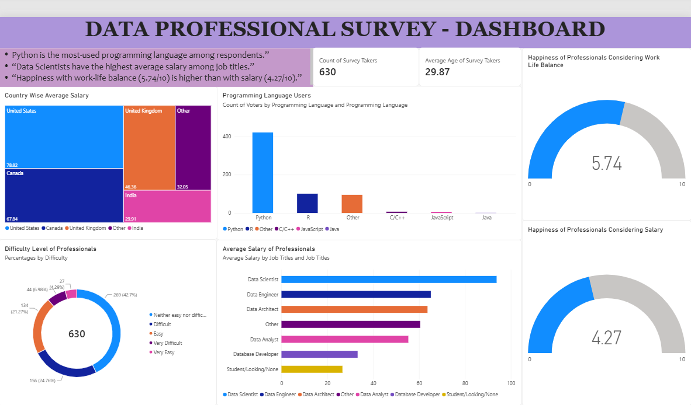

# Data Professional Survey Dashboard (Power BI)

**Goal:** Explore salary, programming language use, and job satisfaction among data professionals.
**Tools:** Power BI (data modelling, DAX measures, visuals, KPI cards)
**Dataset:** Data Professional Survey practice dataset (public, 630 responses)

## What I did
- Built a one-page dashboard with a treemap, bar charts, a donut, gauges, and KPI cards
- Analyzed salary by job title and country, language usage, and happiness scores

## Key insights
- Python is the most-used programming language among respondents.
- Data Scientists have the highest average salary among job titles.
- Happiness with work-life balance (5.74/10) is higher than with salary (4.27/10).

